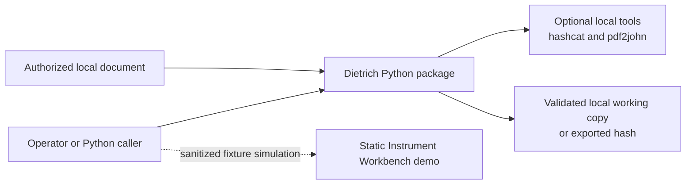
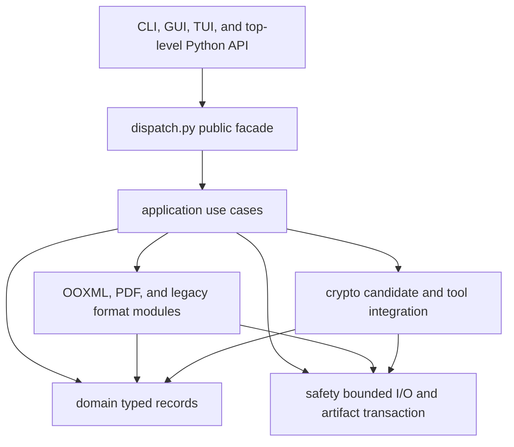
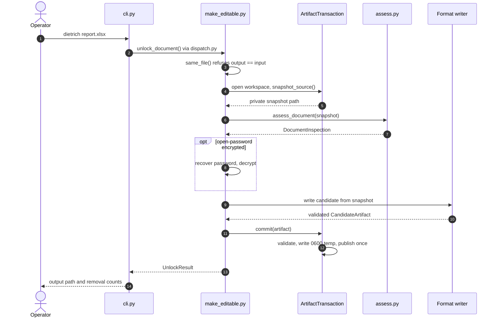
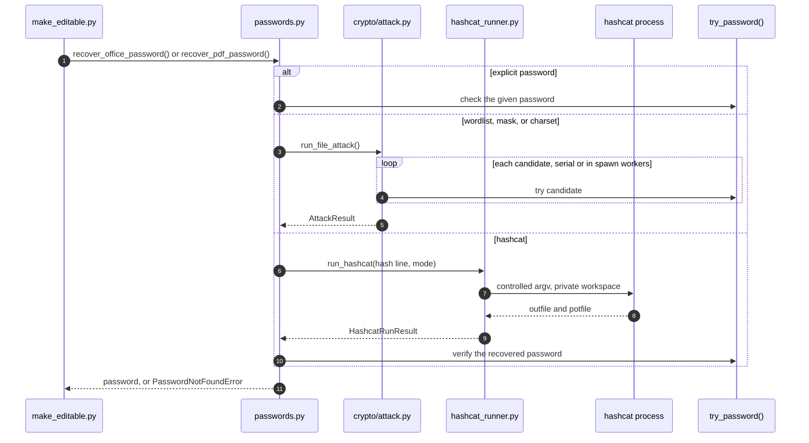
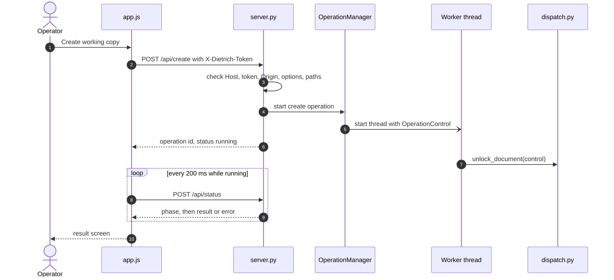
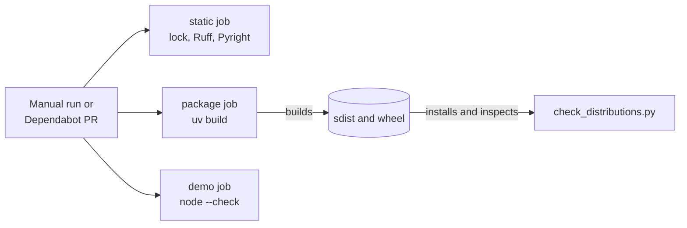

# Architecture

Dietrich is one local Python distribution. It exposes a CLI, a local graphical
interface, an optional Textual interface, and a small public API. It assesses
untrusted Office and PDF input and can produce one validated, editable working
copy. The repository also ships a static browser simulation that never calls the
Python application.

Read this document for component ownership, dependency direction, runtime flows,
and safety invariants. Exact format coverage lives in [ALPHA.md](ALPHA.md), and
user-facing interface details live in [GUI.md](GUI.md) and [TUI.md](TUI.md).

New here? Read in this order: [System context](#system-context) for what runs,
[Components](#components-and-dependency-direction) for where code lives, then
the three journeys: [making an editable copy](#editable-copy-transaction),
[recovering a password](#password-recovery-and-external-processes), and
[a graphical-interface request](#local-graphical-adapter).

## System context

There is no persistent service, remote API, database, account system, or
on-disk application state. The graphical adapter starts a session-authenticated
HTTP server bound only to `127.0.0.1`, and its browser assets ship with the
package. The TUI and graphical interface keep recent paths in memory only. The
static demo has no runtime connection to Dietrich, to local files, or to
external services.

Where in the code:

- `dietrich` command: [src/dietrich/cli.py](../src/dietrich/cli.py)
- `dietrich-gui`: [src/dietrich/gui/\_\_main\_\_.py](../src/dietrich/gui/__main__.py)
- `dietrich-tui`: [src/dietrich/tui/\_\_init\_\_.py](../src/dietrich/tui/__init__.py)
- `dietrich-research`: [src/dietrich/research/cli.py](../src/dietrich/research/cli.py)
- Python API: [src/dietrich/\_\_init\_\_.py](../src/dietrich/__init__.py)
- hashcat and `pdf2john` processes: [src/dietrich/external_tools.py](../src/dietrich/external_tools.py)
- Static demo: [site/](../site/)

The entry points are declared in `[project.scripts]` of
[pyproject.toml](../pyproject.toml).

## Components and dependency direction

The table doubles as a code map, ordered as a newcomer would read it: the shared
records first, then the use cases that sequence them, then the format and
infrastructure packages, then the adapters.

| Component | Responsibility |
| --- | --- |
| [`domain/`](../src/dietrich/domain/) | Pure assessment facts, capabilities, blockers, results, and unpublished `CandidateArtifact` records |
| [`application/`](../src/dietrich/application/) | Complete use-case sequencing for assessment, password resolution, hash export, and editable-copy creation |
| [`dispatch.py`](../src/dietrich/dispatch.py) | Stable public-function facade used by interaction adapters |
| [`operation.py`](../src/dietrich/operation.py) | Thread-safe cancellation, phase polling, and serialized publication entry |
| [`ooxml/`](../src/dietrich/ooxml/) | ZIP package identity, XML transforms, Office encryption, signatures, and validated candidate writing |
| [`pdf/`](../src/dietrich/pdf/) | PDF inspection, password and hash handling, permissions, and validated candidate writing |
| [`legacy/`](../src/dietrich/legacy/) | Verified BIFF/FIB transforms, legacy encryption detection, and fail-closed PowerPoint handling |
| [`crypto/`](../src/dietrich/crypto/) | Bounded password candidates, controlled local hashcat execution, and IRM detection |
| [`safety/`](../src/dietrich/safety/) | Bounded ZIP and CFB access, plus the sole final-publication transaction |
| [`cli.py`](../src/dietrich/cli.py), [`tui/`](../src/dietrich/tui/), [`gui/`](../src/dietrich/gui/) | Input collection and presentation, with no document policy |
| [`research/`](../src/dietrich/research/) | Experimental local OOXML mutation generator behind its own `dietrich-research` entry point, isolated from the document command |

The intended dependency direction is adapters → public facade and application →
format modules → domain and safety. `crypto/` also uses `safety/` for bounded
reads when it probes for IRM markers. The direction is a review rule: no test in
this repository enforces it, so check imports when you review a change.

## Public compatibility boundary

The supported Python boundary is the five functions exported from `dietrich`:
`inspect_document`, `unlock_document`, `inspect_workbook`, `unlock_workbook`, and
`export_document_hash`, together with their exported value and error types. The
exported types include the assessment vocabulary returned on
`DocumentInspection` — `ProtectionLayer`, `Capability`, `CapabilityCode`,
`Blocker`, and `BlockerCode` — so callers can annotate and match against the enum
classes rather than raw strings. The four console entry points (`dietrich`,
`dietrich-tui`, `dietrich-gui`, and the separate lab-only `dietrich-research`),
CLI flags and exit codes, documented JSON and result fields, file formats, and
default output naming are observable contracts too. Internal format functions are
not compatibility facades.

All five functions accept an optional keyword-only `control=None`. Callers can
pass a fresh `OperationControl` and catch `OperationCancelledError`; existing
positional arguments and result fields are unchanged.

## Assessment flow

`application.assess.assess_document` is the single inspection path shared by the
CLI, TUI, Python facade, and other use cases. It classifies the input as PDF,
OOXML, encrypted Office, legacy binary Office, or unknown, applies the IRM gate,
and returns a `DocumentInspection` with typed capabilities and blockers.

Every application use case enforces those blockers before routing to a format
backend or external tool. Presentation code reads typed results instead of
repeating format probes or parsing human-readable notes.

## Editable-copy transaction

What happens when you run `dietrich report.xlsx`:

The CLI only parses flags into `UnlockOptions` (step 2); every decision after
that belongs to `make_editable.py`. The format writer (step 9) is
`write_ooxml_candidate`, `write_pdf_candidate`, or `write_legacy_candidate`,
chosen from the assessment. It works only on the private snapshot and writes into
the transaction workspace, so nothing reaches the target path until step 12. The
GUI, the TUI, and the Python API enter at step 2 through the same facade, so they
share this path. The optional step 8 is shown in detail under
[Password recovery](#password-recovery-and-external-processes).

Where in the code:

- Flag parsing and output naming: [src/dietrich/cli.py](../src/dietrich/cli.py) (`_run_document_command`)
- Public facade: [src/dietrich/dispatch.py](../src/dietrich/dispatch.py) (`unlock_document`)
- Use case and writer routing: [src/dietrich/application/make_editable.py](../src/dietrich/application/make_editable.py) (`_make_editable_copy`, `_write_candidate`)
- Assessment: [src/dietrich/application/assess.py](../src/dietrich/application/assess.py) (`assess_document`)
- Writers: [ooxml/package.py](../src/dietrich/ooxml/package.py), [pdf/permissions.py](../src/dietrich/pdf/permissions.py), [legacy/binary_soft.py](../src/dietrich/legacy/binary_soft.py)
- Snapshot and publication: [src/dietrich/safety/artifact_transaction.py](../src/dietrich/safety/artifact_transaction.py), [src/dietrich/safety/publish.py](../src/dietrich/safety/publish.py)

`application.make_editable.make_editable_copy` owns the entire output-producing
flow:

1. Refuse a target that names the source file (same path or a link to it),
   even with overwrite enabled; the original is never replaced.
2. Create a private transaction workspace and snapshot the source once.
3. Assess the snapshot and reject rights-managed or unsupported input.
4. Resolve an open password and decrypt when necessary.
5. Ask one format module to write an unpublished candidate.
6. Require the writer to validate that candidate.
7. Optionally re-sign and validate a second unpublished OOXML candidate.
8. Validate the final candidate by its concrete artifact kind.
9. Copy it to an adjacent private file and publish exactly once.

Format writers receive source and candidate paths and return a
`CandidateArtifact`. They never choose the final target, decide overwrite
policy, or publish. `ArtifactTransaction` creates a mode-`0600` temporary file
beside the target and completes one atomic replace. A failure before publication
leaves an absent target absent and an existing target unchanged.

`CandidateArtifact.document_format` always describes the concrete output. Its
optional internal `result_document_format` records input provenance: decrypted
Office output keeps its Excel, Word, PowerPoint, or legacy identity for
validation, while public results continue to report `ENCRYPTED_OOXML`. Optional
re-signing preserves that provenance.

Only registered input snapshots can reuse successful ZIP metadata checks, and
only while their file identity and timestamps remain unchanged. Signed-package
policy is enforced on every use. Every new candidate receives fresh metadata and
identity validation. Writer validation and final-publication validation each
read all ZIP members fully for CRC verification; neither pass is skipped.

One publication owner is deliberate. Earlier independent writers could publish
an unsigned output before later signing failed. Centralizing publication gives
every format the same validation, permissions, cleanup, collision, and failure
contract without introducing a general repository or unit-of-work abstraction.
The accepted decision is recorded in
[0001: One artifact transaction owns publication](decisions/0001-single-artifact-transaction.md).

## Format and trust boundaries

- OOXML identity requires exactly one defining main part, checked again before
  publication against the candidate's declared format.
- OOXML validation rejects unsafe names, duplicate aliases, encrypted entries,
  excessive expansion, ambiguous main parts, and signed packages unless
  stripping is explicit.
- Bounded CFB handling limits input, directory entries, per-stream data, and
  aggregate stream data. A directory tree too deep for the parser is rejected
  as invalid input. Mutation resolves complete storage paths and owns FAT
  and MiniFAT traversal with exact-length, index, and cycle checks.
- Office Agile metadata is validated before key work; `spinCount` values above
  1,000,000 are rejected at the shared msoffcrypto boundary.
- Raw PDF encryption-dictionary fallback builds one bounded structural index,
  and marked custom OOXML properties are mutated only after safe XML parsing.
- BIFF mutation requires recognized BOF/EOF-framed substreams; arbitrary marker
  scanning is not permitted.
- Legacy writers use equal-length patches and validate the reopened candidate.
- Rights-managed input fails closed. Dietrich does not obtain a use license.
- Signature stripping is explicit and produces an unsigned copy. Re-signing is a
  limited experimental OOXML subset.

Focused legacy and signature details live in [research/](research/).

## Password recovery and external processes

How an open password is found when the input is encrypted:

`passwords.py` picks exactly one branch from the options. `verify` is the
format's own check: `ooxml.encryption.try_password` for Office and
`pdf.recovery.try_password` for PDF. The local search (steps 3–5) never touches
the document beyond verification, and it stops at the candidate ceiling. For the
hashcat branch, `passwords.py` first exports a hash line from the existing
assessment (`hash_export.export_assessed_hash`). It then checks hashcat's answer
against the document (step 10), so a wrong or `$HEX[...]`-encoded result is never
used as the password.

Where in the code:

- Branch selection: [src/dietrich/application/passwords.py](../src/dietrich/application/passwords.py)
- Candidates and workers: [src/dietrich/crypto/attack.py](../src/dietrich/crypto/attack.py) (`run_file_attack`, `expand_mask`)
- hashcat argv, output parsing, mode choice: [src/dietrich/crypto/hashcat_runner.py](../src/dietrich/crypto/hashcat_runner.py)
- Subprocess limits: [src/dietrich/external_tools.py](../src/dietrich/external_tools.py)
- Hash lines: [src/dietrich/application/hash_export.py](../src/dietrich/application/hash_export.py), [src/dietrich/ooxml/encryption.py](../src/dietrich/ooxml/encryption.py), [src/dietrich/pdf/hash.py](../src/dietrich/pdf/hash.py)

Candidate generation is bounded by an explicit ceiling and kept separate from
document verification. Multiple workers use explicitly owned `spawn` processes,
with at most twice the worker count in outstanding candidates. Submission stops
on success, cancellation, or failure. Every worker is reaped before the snapshot
workspace is released: cooperative shutdown gets a short grace period, followed
by public `terminate()` and `kill()` fallbacks.

A separately owned spawned queue broker avoids parent feeder threads that could
outlive large candidate delivery, and its bounded shutdown completes before the
private snapshot is released. Candidate submission order is stable; parallel
search returns the first completed valid password and then reaps the remaining
workers. Local hashcat integration supports Dietrich-owned wordlist and mask
modes. Native PDF hash extraction is attempted before an optional `pdf2john`
executable fallback.

External commands run without a shell, use private working directories, receive
a reduced environment and closed standard input, capture bounded output, and
write only to Dietrich-owned paths. User-provided hashcat arguments cannot
override controlled modes or output paths, including attached short forms
(`-o/x`), abbreviated long forms (`--potfile-pa=x`), and masks that start with `-`.
Cancellation, timeout, and output
overflow terminate and reap owned processes before removing their workspaces.
POSIX cleanup also targets the process group; Windows uses the direct-child
fallback and does not claim descendant-tree termination there.

## Cancellation lifecycle

Each public operation binds a thread-safe control to its synchronous context.
Checkpoints occur between assessment stages, candidates, archive members,
validation stages, and before publication. Uninterruptible native calls finish
before cancellation takes effect. No Python thread is force-stopped.

`cancel()` returns whether cancellation was accepted. Acceptance and publication
entry share one lock: an accepted cancellation prevents publication; once the
publication phase begins, cancellation is declined and the caller awaits the
result. Read-only completion also serializes with cancellation. Controls are
single-use and expose read-only `phase` and `cancellation_requested` properties.

The TUI owns one operation identifier, control, and Textual worker. It disables
editable controls and recent selection while work runs, retains the awaiter
through backend cleanup, rejects stale completions, and waits before quitting.
Internal hashcat export reuses the checked snapshot assessment; public hash
export always assesses its own input.

## Local graphical adapter

`gui/` owns an ephemeral loopback HTTP session, a bounded local file chooser, and
one active operation. Authenticated JSON requests call the public facade; the
adapter never imports format writers or publication helpers. A worker thread runs
each operation with its own `OperationControl`. The browser polls the operation
identifier and phase, and cancellation waits for backend cleanup. Reloading the
session URL can recover the current operation. Passwords are never included in
serialized results.

What happens when you press "Create working copy" in the browser:

The request returns as soon as the operation starts (step 6); the work runs on
its own thread and enters the same `unlock_document` path as the CLI (step 7).
`OperationManager` allows one operation at a time, so a second start gets
`409 Conflict`. `POST /api/cancel` asks the operation's `OperationControl` to stop;
the browser keeps polling until backend cleanup is finished. Inspection and hash
export use the same pattern through `/api/inspect` and `/api/export`.

Where in the code:

- Browser calls and polling: [src/dietrich/gui/assets/app.js](../src/dietrich/gui/assets/app.js) (`api`, `monitor`)
- Routes and security checks: [src/dietrich/gui/server.py](../src/dietrich/gui/server.py) (`_check_api_security`, `_route_api`, `_create`)
- Request validation: [src/dietrich/gui/options.py](../src/dietrich/gui/options.py) (`build_unlock_options`, `validate_create_paths`)
- Background operation: [src/dietrich/gui/operations.py](../src/dietrich/gui/operations.py) (`OperationManager`)
- Launcher and token page: [src/dietrich/gui/\_\_main\_\_.py](../src/dietrich/gui/__main__.py)

The session token travels in the launch URL fragment and an explicit request
header. Host and Origin validation constrain requests to the local session. Only
bundled, whitelisted frontend assets are served as files; directory browsing
returns bounded metadata through authenticated requests. There is no upload,
remote font, telemetry, browser storage, or general-purpose file-download route.
The session targets a trusted local operator, not shared network hosting. See
[GUI.md](GUI.md) for the complete interaction and process-lifetime contract.

## Build and deployment boundaries

How a change is checked and packaged:

Hatchling builds one source distribution and one wheel. The wheel contains
`src/dietrich`, which carries the six Textual `.tcss` files plus the graphical
adapter's assets, local fonts, and font licenses. `check_distributions.py`
installs both artifacts and checks the four entry points and that asset set. The
source distribution includes maintained source, documentation, examples, brand
assets, scripts, and the demo with its screenshot tour. The test suite is kept
local and is not shipped. Design studies and generated captures are excluded.

All three CI jobs run on Ubuntu with Python 3.12, and only for a manual run or a
Dependabot pull request. CI does not run the test suite; run `uv run pytest`
locally before a change. The repository has no package-publication, container,
installer, or hosted-application workflow.

Where in the code:

- CI jobs: [.github/workflows/ci.yml](../.github/workflows/ci.yml)
- Build configuration: [pyproject.toml](../pyproject.toml) (`[tool.hatch.build]`)
- Artifact checks: [scripts/check_distributions.py](../scripts/check_distributions.py)
- Demo deployment: [.github/workflows/pages.yml](../.github/workflows/pages.yml)

The GitHub Pages workflow is separate and runs only on manual dispatch. It
validates and uploads only the static demo files: the three top-level assets and
the screenshot tour images. It neither packages the Python application nor
processes documents. See [RELEASE.md](RELEASE.md) and [the demo
guide](../site/README.md).

## Extension rules

Add document semantics to the matching format package, cross-format workflow to
`application/`, pure shared records to `domain/`, untrusted I/O limits and final
publication to `safety/`, and input or rendering behavior to the CLI, GUI, or
TUI. New format writers must return validated unpublished candidates and
participate in the same typed blocker and publication contracts.

The project deliberately does not provide IRM bypass, remote recovery, arbitrary
CFB mutation, viewer automation, or remotely hosted document processing.
